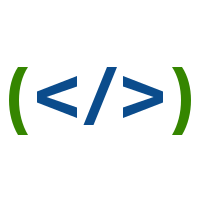

<div align="center">

# Better Brackets (更好的括号)


**让代码的层级结构一目了然 · 优雅、精准、轻量的 JetBrains 系列 IDE 多层级括号色彩与结构辅助插件**

[](https://plugins.jetbrains.com/)
[](https://openjdk.org/)
[](https://plugins.jetbrains.com/docs/intellij/psi.html)
[](LICENSE)
[](https://github.com/Wings-Fantasy/Better-Brackets/releases)

[核心特性](#-核心特性) • [支持语言](#-支持语言) • [视觉辅助](#-视觉辅助) • [调色板与实时预览](#-调色板与实时预览) • [安装使用](#-安装使用) • [本地构建](#-本地开发与构建)

</div>

---

## 🌟 核心特性

- 🎨 **多层级嵌套色彩循环**：为不同嵌套深度的括号赋予区分度高、舒适柔和的色彩，嵌套过深时自动循环平滑过渡，告别“数括号”的烦恼。
- 🎯 **语言语法树（PSI）精准感知**：拒绝粗暴的正规表达式匹配，基于 JetBrains 原生 AST/PSI 语法深度解析，精准区分代码括号、字符串内容、注释与语法符号。
- 📐 **缩进引导线高亮 (Indent Guide)**：层级缩进引导线跟随当前代码层级，清晰展示多层嵌套、分支及循环逻辑。
- 🔍 **作用域动态高亮 (Scope Highlighting)**：光标所及之处，实时圈定并高亮当前代码块、函数体或标签的起止边界。
- 🖌️ **全独立调色板与可视化交互**：每种语言、每类括号均支持独立定制颜色队列；支持一键取色、悬停删除、智能推导补色。
- ⚡ **无感流畅的高性能架构**：深度结合 IntelliJ 异步高亮机制，不卡顿、不影响代码补全与输入体验。
- 🖥️ **跨 IDE 智能环境感知**：针对 IntelliJ IDEA、CLion、Android Studio、WebStorm 等自动适配可用特性，界面清爽无多余干扰。

---

## 💻 支持语言

| 语言 / 语法 | 圆括号 `( )` | 方括号 `[ ]` | 花括号 `{ }` | 尖括号 `< >` | 专属语法增强 |
| :--- | :---: | :---: | :---: | :---: | :--- |
| **Java** | ✔ 方法/条件/强制类型转换 | ✔ 数组声明与下标 | ✔ 类体/方法体/代码块 | ✔ 泛型参数列表 | 严格过滤算术比对符号 |
| **Kotlin** | ✔ 函数调用/控制流 | ✔ 索引访问/解构赋值 | ✔ 类/函数体/Lambda闭包 | ✔ 泛型约束与类型实参 | 字符串模板闭包支持 |
| **C / C++** | ✔ 函数参数/宏调用 | ✔ 数组下标/Lambda捕获 | ✔ 命名空间/类/结构体 | ✔ 模板参数与特化 | CLion / Android Studio 原生适配 |
| **XML / HTML** | — | — | — | ✔ 标签匹配 `<tag>` | 标签名称与括号一体化着色与匹配 |
| **JavaScript / TypeScript** | ✔ 函数/箭头函数/分组 | ✔ 数组字面量/计算属性 | ✔ 对象字面量/函数体/解构 | ✔ TS 泛型参数 | 深度兼容现代 ECMAScript 语法 |
| **CSS** | ✔ calc/var/媒体查询/伪类 | ✔ 属性选择器 `[attr]` | ✔ 样式规则声明块 | — | 复合选择器与层级嵌套支持 |
| **Vue (SFC)** | ✔ 脚本区 JS 表达式 | ✔ 脚本区计算与数组 | ✔ 脚本区对象与代码块 | ✔ 模板标签 `<tag>` | **`{{ }}` Mustache 双花括号插值独立着色**，跨模板/脚本/样式三区无缝协同 |
| **YAML** | — | ✔ 行内列表与端口映射 `[ ]` | ✔ 行内对象与环境配置 `{ }` | — | 自适应层级垂直缩进引导线与作用域高亮 |
| **JSON** | — | ✔ 数组与多维数据列表 `[ ]` | ✔ 对象与多层键值结构 `{ }` | — | 自适应层级垂直缩进引导线与作用域高亮，严格区分字符串字面量与符号 |

---

## 👓 视觉辅助

### 1. 缩进线高亮 (Indentation Line Highlighting)
代码缩进引导线与当前嵌套作用域的色彩完美呼应。在长函数、深层 `if-else` 或大 JSON/配置对象中，一眼辨清当前代码归属。

### 2. 当前作用域高亮 (Scope Highlighting)
当光标在代码内移动时，插件自动计算并高亮当前作用域的外层闭合括号或标签边界，帮助开发者迅速锁定代码执行边界。

---

## 🎨 调色板与实时预览

在 `Settings / Preferences` > `Editor` > `Better Brackets` 中提供两级直观面板：

### 🛠️ Function (功能设置)
- **总控开关**：每门语言具备总控开关；在 IntelliJ IDEA 中自动屏蔽无原生支持的 C++ 选项，在 CLion / Android Studio 中自适应展开。
- **细粒度类型控制**：可对圆括号、方括号、花括号、尖括号、缩进线、作用域分别启用或禁用。
- **内嵌实时预览**：各语言面板自带代码预览编辑器，开关切换即刻呈现高亮效果。

### 🎨 Color (颜色定制)
- **可视化色块**：单击色块唤起取色器任意选色；悬停色块右上角点击 `×` 即可删除。
- **智能梯度补色**：点击 `+` 按钮根据当前色调自动推导并追加和谐的新颜色。
- **即时响应**：修改颜色无需重启或手动保存，预览区域实时跟随渲染。

---

## 🚀 安装使用

### 途径一：从 IDE 插件市场在线安装（推荐）
1. 打开 IDE，进入菜单：`Settings` (Windows/Linux) 或 `Preferences` (macOS) > `Plugins`。
2. 切换至 `Marketplace` 标签页，搜索 **`Better Brackets`** 或 **`更好的括号`**。
3. 点击 `Install`，安装完成后即刻生效，无需重启。

### 途径二：离线安装包
1. 在 [Releases 页面](https://github.com/Wings-Fantasy/Better-Brackets/releases) 下载最新的 `.zip` 插件包。
2. 进入 `Plugins` > 点击齿轮图标 ⚙️ > 选择 **`Install Plugin from Disk...`**。
3. 选择下载的 zip 文件载入即可。

---

## 🛠️ 本地开发与构建

本项目基于 Gradle 与 IntelliJ Platform Plugin SDK 开发，JDK 建议使用 **JDK 21**。

```bash
# 克隆仓库
git clone https://github.com/Wings-Fantasy/Better-Brackets.git
cd Better-Brackets

# 编译 Kotlin 源码
./gradlew compileKotlin

# 本地调试运行（启动 SandBox 沙箱 IDE）
./gradlew runIde

# 构建发布包（产物位于 build/distributions/）
./gradlew buildPlugin
```
